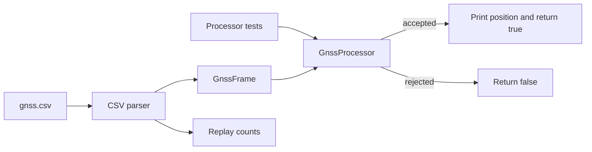

# GNSS Processor

A C++17 implementation of the [GNSS Processor take-home assignment](ASSIGNMENT.md). It validates GNSS frames and replays a recorded CSV log, demonstrating input validation, timestamp handling, configurable quality thresholds, and focused unit tests using only the C++ standard library.

## At a glance

- **Language:** C++17
- **Dependencies:** C++ standard library only
- **Tests:** 29 processor checks; all passed with MSYS2 GCC on Windows
- **Replay sample:** 500 rows, 459 accepted and 41 rejected
- **Programs:** a reusable `GnssProcessor`, a processor test executable, and a CSV replay tool

> This project implements the take-home requirements. Its checks do not certify a position as safe or accurate enough for robot navigation.

## Contents

- [What the project does](#what-the-project-does)
- [Clone the repository](#clone-the-repository)
- [Processing behavior](#processing-behavior)
- [Configuration](#configuration)
- [Build and run](#build-and-run)
- [CSV format and replay](#csv-format-and-replay)
- [Tests and sample results](#tests-and-sample-results)
- [Test case descriptions](docs/TEST_CASES.md)
- [Limitations](#limitations)
- [Project files and further reading](#project-files-and-further-reading)

## What the project does

`GnssProcessor::process()` receives one `GnssFrame` at a time. It checks timestamp ordering and the time gap, validates the measurement and quality fields, then returns `true` for an accepted frame or `false` for a rejected one. Accepted positions are printed to standard output with six decimal places; rejected positions are silent.

The replay program reads `gnss.csv`, validates each row, converts it to a `GnssFrame`, and sends it through the same processor used by the unit tests.



## Clone the repository

Run the same `git clone` command in Windows Command Prompt, PowerShell, or Linux. It creates a `GNSS-Processor` folder in the current directory; then change into that folder before building.

**Windows Command Prompt**

```bat
git clone https://github.com/Im-prove/GNSS-Processor.git
cd GNSS-Processor
```

**Windows PowerShell**

```powershell
git clone https://github.com/Im-prove/GNSS-Processor.git
Set-Location GNSS-Processor
```

**Linux**

```sh
git clone https://github.com/Im-prove/GNSS-Processor.git
cd GNSS-Processor
```

Git must be installed and available on `PATH`, and the destination folder must not already exist.

## Processing behavior

Each frame is checked against the following project policies:

| Check | Default behavior |
| --- | --- |
| Timestamp order | After the first frame, timestamps must strictly increase. |
| Timestamp gap | Reject a newer frame when the gap is greater than 1500 ms. A gap of exactly 1500 ms passes. |
| Coordinates | Latitude and longitude must be finite and within `[-90, 90]` and `[-180, 180]`. |
| `(0, 0)` coordinate | Rejected by default through `Config::reject_null_island`; the option can be disabled. |
| HDOP | Must be finite and between 0 and the configured maximum, inclusive. |
| Satellites | Must meet the configured minimum. |
| Fix type | Accepts `1` (standard GPS) and `2` (mixed); rejects `0` and unknown values. |

The expected input rate is 10 Hz, or about one frame every 100 ms. That interval is nominal: the processor allows jitter and uses the configurable maximum gap to identify longer interruptions.

For every newer packet, the processor advances its received-timestamp baseline before checking measurement quality. A poor-quality packet is rejected but does not make the next normal packet appear out of order. The first packet after an excessive gap is rejected and becomes the new baseline; a following regularly timed packet can recover. Call `reset()` when the caller knows that a new timestamp session has started.

### The `(0, 0)` policy

The default assumes a land-based mobile robot. `(0, 0)` lies in the ocean and is outside the expected operating area; an all-zero coordinate is also a common placeholder before a receiver supplies a fix. This is an application heuristic, not a GNSS rule: it is a real geographic location ([map at 0 degrees latitude, 0 degrees longitude](https://www.openstreetmap.org/?mlat=0&mlon=0#map=5/0/0)). Marine robots and other systems that may operate there can disable the check in `Config`.

## Configuration

The default configuration preserves the assignment's current policies:

| `GnssProcessor::Config` field | Default | Purpose |
| --- | ---: | --- |
| `max_hdop` | `5.0` | Maximum accepted HDOP |
| `min_satellites` | `4` | Minimum satellites used |
| `max_gap_ms` | `1500` | Maximum accepted gap between newer frames |
| `reject_null_island` | `true` | Reject exact `(0, 0)` coordinates when enabled |

This complete example configures a marine robot to accept the exact `(0, 0)` coordinate. Save it as `marine_example.cpp` in the project folder to compile it with the processor:

```cpp
#include "gnss_processor.h"

int main() {
    GnssProcessor::Config config;
    config.max_hdop = 3.0f;
    config.reject_null_island = false;

    GnssProcessor processor(config);
    const GnssFrame frame{1000, 0.0, 0.0, 1.2f, 8, 1};
    return processor.process(frame) ? 0 : 1;
}
```

The constructor does not validate configuration values. Supply sensible limits, including a finite nonnegative HDOP maximum, a suitable satellite minimum, and a positive gap limit.

## Build and run

A C++17 compiler is required. GCC and Clang examples are shown below; the code has no third-party library dependencies.

### Linux

```sh
g++ -std=c++17 -pthread -Wall -Wextra -Wpedantic test_gnss_processor.cpp gnss_processor.cpp -o test_gnss
./test_gnss

g++ -std=c++17 -pthread -Wall -Wextra -Wpedantic replay_gnss.cpp gnss_processor.cpp -o replay_gnss
./replay_gnss gnss.csv
```

### macOS

```sh
clang++ -std=c++17 -pthread -Wall -Wextra -Wpedantic test_gnss_processor.cpp gnss_processor.cpp -o test_gnss
./test_gnss

clang++ -std=c++17 -pthread -Wall -Wextra -Wpedantic replay_gnss.cpp gnss_processor.cpp -o replay_gnss
./replay_gnss gnss.csv
```

### Windows (PowerShell with MSYS2 UCRT64 GCC)

Ensure `C:\msys64\ucrt64\bin` is on `PATH` so the compiler and generated programs can find their runtime DLLs.

```powershell
g++ -std=c++17 -pthread -Wall -Wextra -Wpedantic test_gnss_processor.cpp gnss_processor.cpp -o test_gnss.exe
.\test_gnss.exe

g++ -std=c++17 -pthread -Wall -Wextra -Wpedantic replay_gnss.cpp gnss_processor.cpp -o replay_gnss.exe
.\replay_gnss.exe gnss.csv
```

### Windows (Command Prompt with MSYS2 UCRT64 GCC)

Paste these commands into **Command Prompt** from any directory. They change to the project folder, add MSYS2 GCC to the current terminal's `PATH`, build and run the tests, then build and run the CSV replay:

```bat
cd /d "%USERPROFILE%\Downloads\GNSS Processor"
set "PATH=C:\msys64\ucrt64\bin;%PATH%"
g++ -std=c++17 -pthread -Wall -Wextra -Wpedantic test_gnss_processor.cpp gnss_processor.cpp -o test_gnss.exe && test_gnss.exe
g++ -std=c++17 -pthread -Wall -Wextra -Wpedantic replay_gnss.cpp gnss_processor.cpp -o replay_gnss.exe && replay_gnss.exe gnss.csv
```

To compile the `marine_example.cpp` configuration example above from the project folder, run:

```bat
g++ -std=c++17 -pthread -Wall -Wextra -Wpedantic marine_example.cpp gnss_processor.cpp -o marine_example.exe && marine_example.exe
```

## CSV format and replay

The replay tool expects this exact header and column order:

```csv
timestamp_ms,lat,lon,hdop,satellites_used,fix_type
```

Each data row must contain exactly six unquoted fields:

1. `timestamp_ms`: unsigned decimal integer.
2. `lat`, `lon`, `hdop`: decimal numbers; an optional sign, fractional part, and exponent are supported.
3. `satellites_used`, `fix_type`: signed integer syntax.

The parser trims surrounding whitespace and supports LF and CRLF line endings. It rejects malformed syntax (for example, text in `lon`), NaN/Inf spellings, missing or extra fields, and conversion overflow. A malformed data row is reported with its source line number and skipped; later rows are still processed. A syntactically valid value can still be rejected by `GnssProcessor` if it violates a GNSS policy.

A missing file, invalid header, or read error stops replay with exit status `2`. The parser handles this fixed numeric schema; it is not a general quoted-CSV parser.

## Tests and sample results

The test executable contains 29 named checks covering accepted and rejected frames, coordinate and HDOP boundaries, non-finite values, fix and satellite rules, timestamp ordering and gaps, recovery, configuration, `(0, 0)` enabled/disabled behavior, and `reset()`.

See the [test case guide](docs/TEST_CASES.md) for a numbered description of every check.

All 29 checks passed using MSYS2 GCC with C++17 and warning flags. Replaying the supplied `gnss.csv` produced:

```text
Replay summary: rows=500, accepted=459, rejected=41
```

Malformed-row handling was also checked with CRLF input containing invalid text fields; those rows were reported and replay continued. The replay parser does not have a separate automated integration-test target.

## Limitations

- There is no kinematic or speed-jump check. The assignment does not specify robot speed or receiver error limits, so this implementation does not invent them.
- The processor returns a boolean and prints accepted coordinates. It does not retain the last accepted fix, expose a freshness check, or provide structured rejection reasons.
- HDOP and satellite count alone do not establish position integrity or accuracy. A real navigation stack should use receiver integrity/status data and robot-specific requirements.
- `GnssProcessor` protects per-instance state with a mutex. A separate internal mutex serializes output lines from multiple instances; neither lock sorts concurrently arriving frames by timestamp.
- The CSV reader supports six unquoted numeric fields only.

## Project files and further reading

| File | Description |
| --- | --- |
| [gnss_processor.h](gnss_processor.h) / [gnss_processor.cpp](gnss_processor.cpp) | Frame type, processor API, configuration, validation, timestamp handling, and accepted-position output |
| [test_gnss_processor.cpp](test_gnss_processor.cpp) | 29 processor behavior checks |
| [replay_gnss.cpp](replay_gnss.cpp) | Strict six-column CSV parser and replay summary |
| [gnss.csv](gnss.csv) | Sample recording used by the replay program |
| [ASSIGNMENT.md](ASSIGNMENT.md) | Original take-home assignment and requirements |
| [CANDIDATE_RESPONSE.md](CANDIDATE_RESPONSE.md) | Answers to the assignment's four design questions |
| [RESPONSE.md](RESPONSE.md) | AI assistance disclosure and verification record |
| [docs/CODE_WALKTHROUGH.md](docs/CODE_WALKTHROUGH.md) | High-level pseudocode and repository map |
| [docs/BEGINNER_CODE_WALKTHROUGH.md](docs/BEGINNER_CODE_WALKTHROUGH.md) | Detailed explanation of the implementation and trade-offs |
| [docs/TEST_CASES.md](docs/TEST_CASES.md) | Numbered explanation of all 29 processor tests |
| [docs/ASSUMPTION_TRACEABILITY.md](docs/ASSUMPTION_TRACEABILITY.md) | Rationale, evidence, and limits for implementation decisions |
| [docs/INTERVIEW_PREP.md](docs/INTERVIEW_PREP.md) | Interview questions and answer outlines |
| [docs/SUBMISSION_CHECKLIST.md](docs/SUBMISSION_CHECKLIST.md) | Assignment coverage and submission checklist |
| [docs/GNSS_Processor_Overview.pptx](docs/GNSS_Processor_Overview.pptx) | One-slide design overview |
