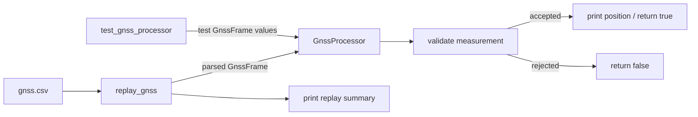

# Code Walkthrough in Pseudocode

This guide gives a high-level, pseudocode-first view of the C++17 GNSS processor. It explains how the source files work together, the processing rules, and the purpose of every project file. For the detailed, source-oriented explanation, see [`BEGINNER_CODE_WALKTHROUGH.md`](BEGINNER_CODE_WALKTHROUGH.md).

## Repository map

```text
gnss_processor.h          Frame definition and processor interface/state
gnss_processor.cpp        Frame validation, timestamp policy, accepted output
test_gnss_processor.cpp   Processor behavior checks
replay_gnss.cpp           CSV reader that feeds frames to the processor
gnss.csv                  Supplied sensor recording
ASSIGNMENT.md             Original assignment prompt
README.md                 Project overview and platform build instructions
CANDIDATE_RESPONSE.md     Candidate answers about design and limitations
RESPONSE.md               AI assistance and verification disclosure
docs/CODE_WALKTHROUGH.md  This high-level pseudocode guide
docs/BEGINNER_CODE_WALKTHROUGH.md  Detailed source explanation
docs/TEST_CASES.md                  Explanation of all 29 processor checks
docs/ASSUMPTION_TRACEABILITY.md    Decisions, evidence, rationale, limits
docs/INTERVIEW_PREP.md             Interview question and answer practice
docs/SUBMISSION_CHECKLIST.md       Assignment coverage and final checks
docs/GNSS_Processor_Overview.pptx  One-slide system overview
```

## Overall program flow

The test program creates frames directly. The replay program parses frames from CSV. Both send each frame to the same processor.



## Data model: `GnssFrame`

```text
GnssFrame contains:
    timestamp_ms       time of the measurement in milliseconds
    lat, lon            measured latitude and longitude
    hdop                horizontal position quality estimate
    satellites_used     number of satellites used for the fix
    fix_type            receiver's fix category
```

The frame is a simple bundle of values. The processor checks whether those values meet the project's acceptance rules.

## Processor pseudocode

```text
process(frame):
    lock this processor's state

    if a previous frame was received and this timestamp is not newer:
        return false

    if a previous frame was received and the time gap exceeds config.max_gap_ms:
        remember this newer timestamp as the new receive baseline
        return false

    remember this newer timestamp as the latest received timestamp

    if latitude/longitude are non-finite or outside their geographic ranges:
        return false
    if config.reject_null_island and both latitude and longitude are exactly zero:
        return false  # default true for land robots; false for marine use
    if HDOP is non-finite, below zero, or above config.max_hdop:
        return false
    if fewer than config.min_satellites were used:
        return false
    if fix type is neither 1 nor 2:
        return false

    print the accepted latitude and longitude to six decimal places
    return true
```

The timestamp is checked before measurement quality. Every newer packet advances the receive-time baseline, including a packet with poor quality or an excessive gap. This lets the next regular packet recover instead of comparing forever against an old timestamp. A repeated or older timestamp returns early and does not change state. The first packet has no prior timestamp to compare, so its timestamp establishes the baseline if its gap check is skipped; it can still be rejected for measurement quality. An accepted frame prints a position. The processor does not retain the last accepted frame.

The policy values are fields in `GnssProcessor::Config`: `max_hdop` (default 5.0), `min_satellites` (default 4), `max_gap_ms` (default 1500), and `reject_null_island` (default true). Set the last field to false for marine robots or other operating areas that include (0,0). `reset()` clears timestamp history when a new stream session begins. The processor uses one mutex for its per-instance state and a separate shared mutex to keep output lines from multiple processor instances from interleaving.

## CSV replay pseudocode

```text
parse command-line arguments
if no CSV path was supplied:
    print usage and stop with an error code

open the selected file
if it cannot be opened:
    report the file error and stop

read the first line
if it is missing or does not match the six expected column names:
    report a header error and stop

for each remaining physical line:
    increment the source line number
    split at commas and trim surrounding spaces
    require exactly six fields
    require timestamp to contain unsigned decimal digits
    require other five fields to use the accepted decimal-number syntax
    convert fields and construct GnssFrame
    if parsing or conversion fails:
        report malformed row and continue to the next line
    call GnssProcessor::process(frame)
    update total, accepted, and rejected counts

if a read error occurred:
    report it and stop with an error code
print the replay totals and exit status
```

The reader supports LF and CRLF line endings and reports physical source row numbers for malformed rows. It expects exactly six unquoted numeric fields and is intentionally not a general quoted-CSV parser. A malformed row never reaches the processor, so it cannot change the processor's timestamp state.

## Test pseudocode

```text
for each named test case:
    create fresh processor state unless the case tests a sequence
    prepare a valid baseline frame and change only the behavior under test
    call process() for one or more frames
    compare true/false results with expected outcomes
    where needed, capture output and verify accepted-position behavior
    report the named case as passed or failed

print passed and failed totals
return success only when no case failed
```

The 29 test cases exercise normal acceptance, quality thresholds and their boundaries, invalid numeric values, coordinate and fix constraints, the exact `(0, 0)` heuristic both enabled and disabled, valid equator/prime-meridian coordinates, timestamp duplicates/order/gaps, timestamp zero, rejected-packet timing, recovery, custom configuration, and reset. These are processor unit tests; replay parsing is described and manually exercised but does not have its own automated integration-test target.

## What each project file is for

- [`gnss_processor.h`](../gnss_processor.h) declares `GnssFrame` and `GnssProcessor`. The frame contains the six measurement fields. The class exposes `process()` and `reset()`, accepts per-instance configuration, and keeps receive-time state private behind a mutex. Keeping the interface in a header lets both the test and replay programs call the same implementation.
- [`gnss_processor.cpp`](../gnss_processor.cpp) defines the thresholds, validates coordinates and quality, enforces strictly increasing timestamps and the maximum gap, maintains processor state, and prints accepted positions. It owns the implementation so policy and state logic have one source.
- [`test_gnss_processor.cpp`](../test_gnss_processor.cpp) contains named checks that exercise the processor directly without CSV input. It provides quick feedback on the rules and edge cases.
- [`replay_gnss.cpp`](../replay_gnss.cpp) is a command-line CSV reader. It validates the header and row syntax, converts valid rows to `GnssFrame`, feeds them to the processor, and reports totals and malformed rows.
- [`gnss.csv`](../gnss.csv) is the sample recording used by the replay tool. It supplies input data; it is not compiled into either program.
- [`ASSIGNMENT.md`](../ASSIGNMENT.md) is the original task statement and describes required behavior and deliverables. Keep it as the reference for what was asked.
- [`README.md`](../README.md) is the quick-start entry point. It summarizes behavior, lists the files, states assumptions, and gives Windows, Linux, and macOS build commands.
- [`CANDIDATE_RESPONSE.md`](../CANDIDATE_RESPONSE.md) is the candidate's written response to the assignment questions, including design choices, limitations, and reported results.
- [`RESPONSE.md`](../RESPONSE.md) records AI assistance and verification information for disclosure.
- [`CODE_WALKTHROUGH.md`](CODE_WALKTHROUGH.md) is this concise system-level pseudocode guide.
- [`BEGINNER_CODE_WALKTHROUGH.md`](BEGINNER_CODE_WALKTHROUGH.md) is the more detailed, source-oriented explanation, including implementation reasoning and trade-offs.
- [`TEST_CASES.md`](TEST_CASES.md) describes each named processor check and the behavior it verifies.
- [`ASSUMPTION_TRACEABILITY.md`](ASSUMPTION_TRACEABILITY.md) connects each chosen behavior to code/tests, its source or rationale, and its limitations.
- [`INTERVIEW_PREP.md`](INTERVIEW_PREP.md) contains likely technical questions, suggested answer outlines, and discussion points for explaining the solution.
- [`SUBMISSION_CHECKLIST.md`](SUBMISSION_CHECKLIST.md) maps assignment requirements to the evidence in the project and notes submission-specific follow-ups.
- [`GNSS_Processor_Overview.pptx`](GNSS_Processor_Overview.pptx) is a one-slide visual summary of the system for presentation or review.

The generated `.exe` files and `InstallationLog.txt` are not retained in the project: executables can be rebuilt from the `.cpp` sources, and the log was an incidental installer artifact.

## Build and run

From the project directory, build and run the processor tests:

```sh
g++ -std=c++17 -pthread -Wall -Wextra -Wpedantic test_gnss_processor.cpp gnss_processor.cpp -o test_gnss
./test_gnss
```

Build and run the CSV replay tool:

```sh
g++ -std=c++17 -pthread -Wall -Wextra -Wpedantic replay_gnss.cpp gnss_processor.cpp -o replay_gnss
./replay_gnss gnss.csv
```

See [`../README.md`](../README.md) for platform-specific commands and [`BEGINNER_CODE_WALKTHROUGH.md`](BEGINNER_CODE_WALKTHROUGH.md) for the detailed source explanation.
